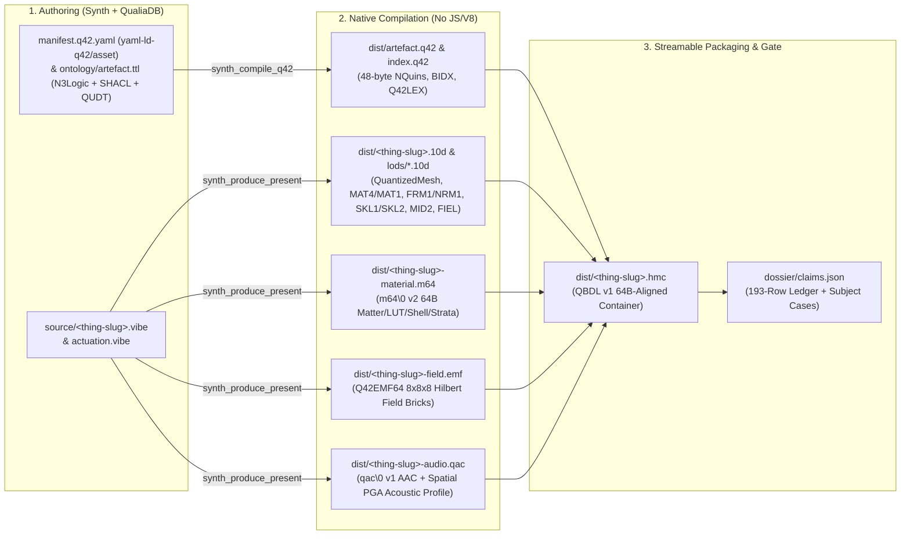

# Qualia Poiesis (`github.com/qualia-poiesis`) — Made-World, Artefact, and Creative/Intellectual Works Hypermedia (`.hmc`) Repositories

**GitHub Organization:** `https://github.com/qualia-poiesis`  
**Local Multi-Repo Root:** `C:\github\poiesis\<thing-slug>\`  
**Development Tool:** Webizen AI Synth (`0.0.41.12`, 150 Hypermedia morphisms) + QualiaDB + Etalon  
**Visitor & Host Runtime:** QualiaPortal + Webizen Desktop / World Host  

---

## 1. Domain Boundary: Poiesis ("World of Man") vs. IntentEco ("World of God")

This organization governs **one-repository-per-asset** production for human-made things, assemblies, built environments, and creative or intellectual works (**"World of Man"** / `made:*` and `soc:*` domain families).

> [!IMPORTANT]
> **Strict Domain Separation (`DOM-AX-1`):**
> - **Biosphere & Natural World ("World of God" — `bio:*` / `env:*`):** All living organisms, flora, fauna, fungi, ecological communities, and natural geological formations belong in **[`https://github.com/intenteco`](https://github.com/intenteco)** (local workspace `C:\github\eco-intent\<species-slug>\`) under the **Social Permissive Commons (`SPC`)** inalienable living-world commons model. Never commit living species embodiments to `qualia-poiesis`.
> - **Made World & Creative/Intellectual Works ("World of Man" — `made:*` / `soc:*`):** Every manufactured artefact, vehicle, sign, tool, machine, building, infrastructure element, or creative/intellectual work requires its own dedicated repository inside **`https://github.com/qualia-poiesis/<thing-slug>`** (local workspace `C:\github\poiesis\<thing-slug>\`).
> - **Cross-Domain Provenance:** A living tree is an organism in `intenteco`; its nursery planter, greenhouse, irrigation pump, or a milled timber beam installed in a workshop is a made-world artefact in `qualia-poiesis`, linked to its natural source by explicit provenance and act relations (`prov:wasDerivedFrom`) without collapsing their identifiers.

### Scope of `qualia-poiesis` Repositories

Each repository in `qualia-poiesis` represents one well-defined **design family, manufactured artefact, built structure, or creative/intellectual work**, such as:

1. **Vehicles & Mobile Machinery (`made:Vehicle` / `made:MobileMachine`):** Specific cars, 4WD field utility/survey rovers, trucks, bicycles, trains, watercraft, aircraft, and autonomous robotics.
2. **Street Furniture, Signage & Infrastructure (`made:Signage` / `made:Infrastructure`):** Regulatory and wayfinding road signs, traffic signals, street lamps, utility poles, solar microgrids, battery banks, water filtration plants, and telecommunications masts.
3. **Buildings & Architectural Structures (`made:Building` / `made:Structure`):** Civic hubs, workshops, residential dwellings, bridges, greenhouses, sheds, and modular interiors (with operable doors, windows, rooms, and service connections).
4. **Tools, Devices & Manufactured Products (`made:Device` / `made:Tool`):** Laptops, smartphones, scientific instruments, hand tools, furniture, containers, and industrial equipment.
5. **Creative, Media & Intellectual Works (`soc:CreativeWork` / `hcf:HypermediaDocument` / `si:SemanticInstrument`):** Authored publications and documents (`yaml-ld-q42/hcf`), declarative QApp manifold workspaces (`yaml-ld-q42/workspace`), acoustic/musical works, theatrical/cinematic stages, interactive exhibits, educational instruments, and kinetic sculptures.

---

## 2. Core Purpose: Streamable, Dynamically Loadable, Physics- & Material-Complete Digital Twins

Assets in `qualia-poiesis` are **not** static triangle meshes with a category label. Every asset is produced as a self-contained, cryptographically sealed **Hypermedia Container (`.hmc`)** that functions as an inspectable, streamable, and dynamically loadable digital twin with complete physics, material, semantic, and behavioral definitions.



### How Dynamic Loading & Range-Fetch Streaming Work

1. **64-Byte-Aligned Intact Payloads (`QBDL` v1 `.hmc`):**
   - An `.hmc` file consists of a 64-byte header (`QBDL` magic, version, entry count, index offset/length, whole-file CRC-32C), followed by **64-byte-aligned intact file payloads**, and a **CBOR index footer** (`BundleEntry { key, kind, offset, length, sha256, meta }`).
   - Because every interior payload is stored uncompressed/intact at a 64-byte boundary, interior `.q42`, `.10d`, `.m64`, `.emf`, and `.qac` offsets resolve directly under zero-copy `mmap` on native hosts or **HTTP `Range` (`206 Partial Content`)** requests over the network (`entry.offset + segment.offset`).
2. **Manifest-First Inspection & Selective Residency (`REQ-HMC-003`, `DTA-PKG-09`):**
   - The runtime fetches or maps the `.hmc` header, CBOR footer index, and `.q42` semantic graph **before** decoding heavy geometry or media payloads.
   - A scene or visitor runtime can inspect the entire Bill of Materials (BOM), semantic identifiers, physical mass, port compatibility, and available variants (`film`, `open_world_game`, `cartoon`, or LODs `lod0`..`lod2`) and admit **only the selected representation's dependency closure** into GPU/CPU residency.
3. **Separate Address Spaces (`QBDL` Index vs. `Q42 BIDX`):**
   - The `.hmc` footer index maps container entries (`kind="q42"`, `"10d"`, `"m64"`, `"emf"`, `"media"`, `"manifest"`).
   - Inside a `.q42` entry, the internal `BIDX` (Block Index) maps subject/object hashes to contiguous 40,960-byte LZ4-compressed SuperBlocks of 48-byte `NQuin` quads.
   - Partial or streamed extents are staged as untrusted until verified against the committed entry SHA-256 digest or chunk proof; unverified bytes are never executed.
4. **Immutable Definition vs. Mutable `InstanceState64` & State Journals (`REQ-HMC-007`):**
   - The published `.hmc` is immutable. Individual spawned instances in a world scene (e.g., 50 parked cars or 200 street signs) share the single admitted `.hmc` definition in memory while maintaining per-instance state via a 64-byte **`InstanceState64`** descriptor (seed, wear/weathering age, paint/configuration variant, operational state vector) and an external state journal bound to the release digest.

---

## 3. Native File Formats & Their Roles

Every complete asset repository produces and packages the following native QualiaDB / Hypermedia formats:

| Extension | Magic / Codec | Role in the Asset Architecture | Key Internal Sections & Contents |
| :--- | :--- | :--- | :--- |
| **`.hmc`** | `QBDL` v1 | **Hypermedia Container** — Canonical distribution unit for a complete embodiment. | 64B header + 64B-aligned (or optional 4096B OS-page-aligned via `BUNDLE_FLAG_PAGE_ALIGN_4096 = 0x0001`) intact `.q42`, `.10d`, `.m64`, `.emf`, `.qac`, preview media, provenance, and CBOR `BundleEntry` footer + whole-file CRC-32C. |
| **`.q42`** | `Q42\0` v3/v4 | **Unified Semantic Graph Volume** — Authoritative knowledge, ontology, BOM, physics traits, and rights. | 256B header (v3 readable, v4 written), embedded namespaced `Q42LEX` lexicon, `BIDX` (+ optional `FIDX`/`PIDX`) indexes, 40,960B LZ4-compressed SuperBlocks of 48-byte `NQuin` records, Merkle-DAG provenance, publication flags (`FLAG_PERMISSIVE_COMMONS 0x0020`, `FLAG_SANCTUARY 0x0040`). |
| **`.10d`** | `10d\0` v1/v2 | **10-Dimensional Computational & Epistemic Manifold Container** — Primary neuro-symbolic & multi-scale (`L0`–`L6`) computational model (`[q, v, w, x, y, z, t, α, μ, σ]`), plus coupled 3D/4D geometry (Mode-A inline constituency or Mode-B `AREF` archetype reference), materials (`MAT4`), rig (`SKL2`/`SSM1`), and spatial fields. | 64B header (`axis_roles[10]` for `[q, v, w, x, y, z, t, α, μ, σ]`: `q` reality/hypothesis/mixed-zone superposition, `v` topological metric regime, `w` domain head, `x,y,z,t` 4D spacetime, `α` semantic pull, `μ` `CoordinateCarrier` cryptographic provenance, `σ` spectral/logical signature), 24B `SectionDescriptor` table: `ManifoldIdentityV2` (`MID2`), `Tensor10DNodes` (`2`), `FieldSidecar` (`8`: `FRM1`/`NRM1`, `MRP1`, `FIEL`, `GTOP` `0x0300`, `AREF` `0x0301` archetype reference, `IOVR` `0x0302` instance overrides, `INST` `0x0303` multi-instance population batch, `MSTR` `0x0304` `L0`–`L6` multi-scale strata, `CBLD` `0x0305` UTF-8/UTF-16 & CBOR-LD Symbolic-AI/RDF payload), `EntityOntology` (`EONT` `17`), `ProceduralSynthesis` (`PROC` `18`), `QuantizedMesh` (`1`), `Materials` (`MAT4` `13`), `TextureCoordinates` (`UV01` `14`), `Topology` (`10`), `SpatialIndex` (`11`), `SkeletalAnimation` (`SKL1`/`SKL2` + `SSM1` `16`), `ClusterDag` (`CDAG` `23`), `CorrespondenceMap` (`FEMC` `9`). |
| **`.m64`** | `m64\0` v2 (or `e64\0`, georaster v3) | **Matter-64 Container** — 64-byte L1-cache-aligned physical matter, constitutive LUT, B-Rep shell, and subsurface grid. | 64B header + chunk directory + 64B records across modes: `Point` (`0x00`), `Holo` (`0x01`), `Strata` (`0x02`), `PhaseJuncture` (`0x03`, Cauchy stress / excavation / cartoon wafer), `Shell` (`0x04`, Radial-Edge B-Rep faces), `BioTissue` (`0x05`), plus `Q42ConstituentLutEntry` (64B optical BRDF, Kubelka-Munk, bulk density $\rho$ in $\text{kg/m}^3$, porosity, friction angle, Mohr-Coulomb cohesion in $\text{kPa}$, Young's modulus $E$ in $\text{MPa}$, Poisson's ratio $\nu$, Darcy permeability, dielectric permittivity $\varepsilon_r$, electrical conductivity, P-wave acoustic velocity, `did:q42` material FNV-1a hash, and per-entry CRC-32C / chunk BLAKE3 seal). |
| **`.emf`** | `Q42EMF64` v2/v3 (contract v4) | **Electromagnetic, Thermal & Wave-Optical Field Container** — 3D Hilbert-ordered $8\times8\times8$ volumetric bricks (512 cells = 32 KiB per brick, up to `MAX_DENSE_CELLS = 1,048,576`). | 64B header + chunk directory (with 256-bit BLAKE3 chunk seals and CRC-32C) + 64B `EmfCellRecord64` cells storing $\mathbf{E}$ ($\text{V/m}$), $\mathbf{B}$ ($\text{T}$), Poynting flux, `wavelength_nm`, complex refractive index $n/\kappa$, coherence phase, Stokes polarization ($I, Q, U, V$), `spectral_sigma` ($\sigma$), and `confidence_alpha`. Referenced in `.10d` via `MID2` `FIELD_KIND_ELECTROMAGNETIC` (`0x0100`). |
| **`.qac` / `.aac` / `.wav`** | `qac\0\0\0\0\0` v1 / AAC / PCM | **Spatial Acoustic & Compressed Audio Container** — Produced via `hypermedia.acoustics.encode_aac` (`format: "qac"` or `"aac"`, bitrate `16000..320000` bps) or `encode_wav`. | `.qac` wraps AAC-encoded / multi-modal acoustic streams (`cue_profile: "acoustic_pcm_stft_hoa_modal_v1"`, PCM/STFT/Higher-Order Ambisonics/modal cues, and EBU R128 LUFS / VBAP 5.1 / Camelot DAW verification metadata) alongside Projective Geometric Algebra (PGA) spatial zone routing (`spatialize_pga_zone`). |
| **`.vibe`** | UTF-8 VibeScript | **Editable Procedural CAD, Material, Physics & Actuation Source** — Authoritative native recipe. | Calls the 150 Hypermedia morphisms via `capability.invoke(...)` to construct parametric geometry, booleans, lofts, multi-part assemblies (`sweep_assembly_profile`), UVs, PBR BSDFs, XPBD physics constraints, kinematics, `.m64`, `.emf`, `.qac`, and runtime actuation hooks without JavaScript or V8. |
| **`.ttl` / `.n3`** | UTF-8 Turtle / N3 | **Human-Readable Semantic Source** — Compiled into `.q42` via `synth_compile_q42` (or `qualia-cli ingest`). | Defines `made:*` design vs. instance hierarchy, component BOM, QUDT physical quantities/units, functional ports/subsystems, SHACL validation shapes, and contributor/licensing agreements. |
| **`yaml-ld-q42`** (`manifest.q42.yaml` / `.hcf.yaml` / `.qapp.yaml`) | UTF-8 YAML-LD v2 (`compile_yaml_ld_q42_auto`) | **Unified Asset Manifest, Declarative QApp Workspace & HCF (`HypermediaDocument`) Source** — Compiled directly into 48-byte `NQuin` records + `Q42LEX` lexicon entries (`crates/qualia-core-db/src/q42/yaml_ld_q42.rs`). | Auto-dispatches three shapes: **(1) `yaml-ld-q42/asset`** (`@type: HypermediaAssetManifest` in `manifest.q42.yaml`, unifying Synth project config, `epistemic_zone`, `embodiment_mode`, `coordinates_10d`, `archetype_ref`, `computational_strata` `L0`–`L6`, multilingual UTF-8 `labels`, DCAT `distributions:`, `profiles:`, `components:`/`organs:`, `ports:`, `instance_state_64:`, and `lods:` into `dist/index.q42`), **(2) `yaml-ld-q42/workspace`** (`@type: WebizenWorkspace`, `pages:`, `panes:` with packed `(x,y,w,h)` bounding boxes, and Phase 5 Manifold World `views:` `Scene3D`/`Pane2D`), and **(3) `yaml-ld-q42/hcf`** (`@type: HypermediaDocument`, `content:` sections & blocks for creative/intellectual works and documentation). |

---

## 3.1 Computational Primacy, Multi-Scale (`L0`–`L6`) Depth & Two-Tier `.10d` Geometry Constituency

### 1. Computational Primacy Over Visual and Auditory Embodiment
In QualiaDB, **the 3D/4D visual model or auditory stream (`.qac`) is NEVER the primary entity.**
- **The Primary Object is the 10D Neuro-Symbolic Computational Model (`.q42` + `.10d` `MID2` / `Tensor10DNodes` / `EONT` / `PROC` / `FIEL` / `MSTR`):**
  - Represents **empirical reality**, **scientific hypothesis synthesis** (`q` superposition), or **creative/intellectual work in a mixed zone** (where empirical facts, counterfactual simulations, civic policy scenarios, and creative works coexist with explicit Belnap 4-valued paraconsistent truth and provenance weights on $\mu$).
  - Visual 3D/4D geometry (`.10d` `QuantizedMesh`, `CDAG`, `SKL2`/`SSM1`), physical matter (`.m64`), electromagnetic/radiance fields (`.emf`), and spatial acoustics (`.qac`) are **bidirectionally coupled secondary embodiments** driven by—and feeding back into—the computational model (e.g., via `FEMC` volumetric finite-element-to-surface deformation, `EONT` metabolic/damage/wear state driving `SSM1` morph weights, and `PROC` ODE laws).

### 2. The 7-Layer Multi-Scale Computational Hierarchy (`L0`–`L6` via `FIELD_KIND_MULTISCALE_STRATA = 0x0304`, `MSTR`)
While a visual representation of a species (`intenteco`: flora, fauna, funga) or a made-world thing (`qualia-poiesis`: vehicles, buildings, tools) may initially depict only the macro outer shape (such as the surface mesh of a leaf, skin, or a chassis panel), the underlying `.10d` computational data structure encodes **seven nested computational strata (`L0`–`L6`)** anchored to host geometric k-cells via [`CellAnchor`](file:///c:/github/qualiaDB/crates/qualia-core-db/src/topology/header.rs):

| Stratum | Scale Range | Computational Constituents & Coupling |
| :--- | :--- | :--- |
| **`L0` Macro-Entity / Holobiont / Assembly** | $10^2\text{ m} \dots 10^{-1}\text{ m}$ | Complete tree, animal, fungal network, building, vehicle, or mixed-zone creative/hypothetical system (`MID2`, `EONT`, `SKL2`, `CDAG`). |
| **`L1` Organ / Subsystem** | $10^{-1}\text{ m} \dots 10^{-2}\text{ m}$ | Leaf lamina/petiole, vascular cambium, heart, root system; engine block, PCB, structural beam (`GTOP` `0x0300`, `FEMC`, `FIEL`). |
| **`L2` Tissue, Micro-Appendage & Histological Architecture** | $10^{-2}\text{ m} \dots 10^{-4}\text{ m}$ | **Hair follicles, trichomes, stomatal guard complexes**, epidermis, palisade/spongy mesophyll, xylem tracheids, osteons/trabeculae (`.m64` `M64BioTissueRecord`); weld zones, coatings (`PROC` Voronoi/allometry). |
| **`L3` Harboured Consortia: Fungi, Bacteria, Microbiome & Parasites** | $10^{-3}\text{ m} \dots 10^{-6}\text{ m}$ | **Endophytic & mycorrhizal fungi, phyllosphere/rhizosphere/follicular/gut bacterial biofilms, mites, nematodes, galls, mistletoe, viral/cellular parasites** (and timber-rot fungi or corrosion biofilms on made-world things). Each co-habiting organism links via RDF `NQuin` (`taxon_or_ontology_iri_hash`) to its own canonical `intenteco` `.10d`/`.q42` taxon model. |
| **`L4` Cellular & Organellar Stratum** | $10^{-4}\text{ m} \dots 10^{-7}\text{ m}$ | Individual cell populations (mesophyll cells, keratinocytes, follicle stem cells, neurons, fungal hyphae, bacterial cells) and organelles (chloroplasts, thylakoids, mitochondria, cell walls/membranes) with turgor pressure and membrane potential. |
| **`L5` Molecular, Genomic & Biochemical Pathway Stratum** | $10^{-7}\text{ m} \dots 10^{-9}\text{ m}$ | DNA/RNA/protein sequences (`bioinformatics_align`), enzymatic reaction centers (RuBisCO, ATP synthase, cytochrome P450), biopolymers (cellulose, lignin, keratin, collagen), and alloy crystal lattices. |
| **`L6` Quantum Physics Stratum (`L6_QuantumPhysics`)** | $10^{-9}\text{ m} \dots 10^{-15}\text{ m}$ | All **non-classical quantum-mechanical considerations not reducible to general/classical physics or continuum mathematics** (with Quantum Dynamics and Quantum Chemistry as sub-domains): **(a) Quantum Coherence, Superposition & Entanglement** (density matrices $\hat{\rho}$, von Neumann entropy $S_{\text{vN}}$, non-commutative observables $[\hat{A}, \hat{B}] \neq 0$), **(b) Open-System Quantum Dynamics, Tunneling & Spin Physics** (GKSL Lindblad / Redfield decoherence $T_1, T_2^*$, WKB/instanton proton & electron barrier tunneling, vibronic exciton coherence, Zeeman/hyperfine radical-pair spin dynamics, spintronics), **(c) Cavity QED & Topological/Many-Body Quantum Phases** (polaritonic coupling, Casimir dispersion, Berry curvature, Chern invariants, superconducting/BEC condensates), and **(d) Quantum Chemistry Subset (Electronic Structure)** (contracted GTOs `basis_set.rs`, OS/HGP/Rys integrals `integrals.rs`, RHF/UHF DIIS/Broyden SCF `scf.rs` to $10^{-8}\text{ Ha}$, Rust-native autodiff LDA/GGA DFT `dft.rs`, and Q-Forge VQE StateVector `NQuin` pointers `qpu_extension.rs`). |

Each stratum node records its `EmbodimentResolutionState` (`ComputationalOnly`, `ProceduralSynthesized`, `ArchetypeReferenced`, `InlineEmbodied`), allowing deeper strata (`L2`–`L6`) to operate immediately in the computational model and progressively gain visual/3D embodiments over time as multi-scale zooming is authored.

### 3. Two-Tier `.10d` Geometry Constituency vs. External Reference (`AREF`, `IOVR`, `INST`)
Paralleling how `.emf` (`Q42EMF64`), `.qac` (`qac\0`), and `.m64` (`m64\0`) were factored out of the original monolithic 10D concept into dedicated domain containers, `.10d` v2 supports three embodiment profiles:
1. **Profile 0 (`computational_only`):** Pure 10D computational, hypothesis, or mixed-zone creative manifold (`MID2` + `Tensor10DNodes` + `MSTR`/`CBLD`/`FIEL`/`EONT`/`PROC`) requiring no visual mesh.
2. **Profile 1 / Geometry Mode A (`archetype_inline`):** The canonical master embodiment produced per repository in `qualia-poiesis` or `intenteco`, embedding shared heavy geometry (`QuantizedMesh`, `CDAG`, `MAT4`, `UV01`, `SKL2` rig, `SSM1` PCA shape basis) inline.
3. **Profile 2 / Geometry Mode B (`archetype_instance`):** An individual placed entity (e.g., a specific tree at hillside 10D coordinates `[q, v, w, x, y, z, t, α, μ, σ]` or a specific vehicle with unique wear/owner DID) or a 10,000-entity population (`Tensor10DNodes` + `FIELD_KIND_INSTANCE_BATCH = 0x0303` `INST`). It **omits duplicate geometry sections** and references the shared Mode-A Archetype `.10d` by its 256-bit `BLAKE3`/`SHA-256` digest via **`FIELD_KIND_ARCHETYPE_REF = 0x0301` (`AREF`)** while supplying per-instance computational state (`MID2`, `EONT`, `PROC` 64-bit seed, `MSTR` consortia/quantum strata, and `FIELD_KIND_INSTANCE_OVERRIDES = 0x0302` `IOVR` `SSM1` shape weights).

### 4. Symbolic-AI, RDF 1.2, Logic Infrastructure & Strict No-ASCII Policy (UTF-8 / UTF-16 & CBOR / CBOR-LD)
- **Strict No-ASCII Policy:** All human-readable text, multilingual labels (including Indigenous Australian languages such as Arrernte `@rer`, CJK `@zh`, Arabic `@ar`, and scientific notation), and RDF IRIs MUST use **UTF-8** (or lossless **UTF-16** at platform/ABI boundaries), encoded in binary containers via **CBOR / CBOR-LD (`FIELD_KIND_SYMBOLIC_RDF_CBOR_LD = 0x0305`, `CBLD`)** and `.q42` `Q42LEX` tables. Fixed 4-byte binary section tags are 32-bit numeric format discriminants (`u32`), never ASCII strings.
- **Innate Symbolic-AI & Logic Infrastructure:** Every `.10d` entity and `L0`–`L6` stratum is anchored to 48-byte `NQuin`s (including RDF 1.2 / RDF-Star `TAG_EMBEDDED` reified statements) and governed by QualiaDB's **N3Logic, SHACL, zero-heap `SLG-VM` tabling solver, Belnap 4-valued paraconsistent logic, and Deontic governance (`OP_PERMIT`, `OP_OBLIGE`, `OP_FORBID` + `DEFEATER_BIT`)**.

### 5. Holographic Phase-Space Primacy (`FIELD_KIND_HOLOGRAPHIC_PHASE_SPACE = 0x0306`, `HOLO`) & Memory Budgets
- **In-Situ Holographic Energy Tensors (`HOLO` `0x0306` + `M64HoloRecord` Mode `0x01`):** Every `.10d` v2 asset produced by Synth / `hypermedia-production` (or upgraded from legacy B-Rep `.10d` files via `upgrade_legacy_10d_to_holographic_v2`) embeds a 64-byte `HolographicPhaseHeader` + `M64HoloRecord` array carrying 12 `f16` Bessel/Spherical SDF harmonics, eigen-frequencies ($\omega_k$), damping ratios ($\zeta_k$), and 6-band (380–780 nm) spectral power distribution (`spectral_spd_base`), plus optional 64-byte `EulerianWavefieldRecord` rows.
- **Hamiltonian Stationary-Action Splines ($\delta S = 0$), Hyperbolic $v=2$ Möbius Morphogenesis & Scale-Space Harmonic LODs ($k=0..K$):** Time $t$ and environmental forces (wind/water drag) evaluate continuous analytical Cubic Hermite Hamiltonian phase trajectories (`evaluate_hamiltonian_stationary_action_spline_zero_heap`), Poincaré ball Möbius transformations (`evaluate_hyperbolic_mobius_morphogenesis_zero_heap`), and automatic scale-space harmonic truncation ($k = 0..K_{\text{active}}(d)$). When `QuantizedMesh` is omitted, `decode_load_10d` synthesizes an 8-vertex, 12-triangle proxy bounding lens and raymarches the analytical SDF in `< 32` steps (TDR guardrail).
- **Memory Budget Distinction (42 MiB Q42 Sentinel vs. Streaming Asset/Scene Containers `> 42 MiB`):** The **42 MiB Sentinel** strictly governs the Q42 reasoning / `SlgArena` hot-paths and zero-heap per-frame kernels; asset and scene containers (`.10d`, `.m64`, `.emf`, `.hmc`), like `.p64` LLM weight files, use zero-copy `mmap` / streaming container budgets that can exceed 42 MiB (up to **128 MiB** per `.10d` ring and **2 GiB** aggregate in `production16`).

---

## 4. Physics, Materials, and Kinematics Architecture

A `qualia-poiesis` asset must separate **render appearance** from **physical mechanics** while binding both to the exact same component identifiers (`REQ-MADE-005`, `DTA-VIS-04`, `DTA-PHY-01..09`):

### 4.1 1:1 SI Metric Authoring Invariant (`DTA-ID-05`)
- **Metric Frame (`1.0 unit = 1.0 metre`):** Every vehicle, sign, building, tool, or device MUST be authored in 1:1 SI metres (`+X` East/Right, `+Y` Up, `-Z` North/Forward) with the root pivot at basal ground or mounting contact (`y = 0.0 m`).
- **Small / Precision Artefacts:** Micro-components or precision subassemblies may declare `qudt:Millimeter` in `artefact.ttl`, with an explicit unit transform into the 1:1 metre world frame.
- **No Viewport Normalization:** Multi-asset scenes run with `QualiaPortal::set_preserve_authored_frame(true)`. A laptop (`0.31 m` wide), a road sign (`2.4 m` tall), and a utility vehicle (`4.95 m` long) must coexist at true physical scale without manual rescaling.

### 4.2 Dual Material Architecture: Render BSDF (`MAT4` / `MAT1`..`MAT3`) vs. Physical Matter (`.m64` + `.q42`)
- **Visual Surface (`hypermedia.surface.*` $\to$ `.10d` `Materials` `MAT4`):**
  - UV unwrapping via `hypermedia.surface.unwrap_slim` (`mode: "slim"` for 1:1 vertex `UV01`, or `"atlas"` for `uv_atlas` harmonic disk charts with explicit seams) and tangent generation via `hypermedia.surface.compute_mikktspace`.
  - Principled BSDF graphs (`hypermedia.surface.compile_bsdf_graph` with `closure: "principled_v2" | "chiang_hair" | "fournier_forand_water" | "random_walk_sss"`) and procedural/baked PBR maps (`hypermedia.surface.synthesize_maps`, `bake_pbr_materialx`, `compile_10d_pbr`) defining metallic, roughness, clearcoat (automotive paint), transmission/IOR (glass windshields, display screens), retroreflection (traffic signage sheeting), and emission.
  - Multi-part assembly binding (`hypermedia.manifold.sweep_assembly_profile`): packs named component submeshes (`parts: [{ key, mesh, semantic_id, translation?, rotation?, color, roughness, metallic, shading }]`) into a single `.10d` container (`assembly.container_10d`) while emitting `assembly.turntable_png` and `assembly.blueprint_svg`.
  - Weathering and state variations (`MAT-07`): clean/factory, dust/mud accumulation, oxidation/rust, scratches, wetness, and thermally active states driven by `InstanceState64`.
- **Physical Matter (`hypermedia.geodesy.compile_m64` + `.q42` QUDT traits):**
  - Visual shaders never guess mechanical mass or strength. Each component binds to physical material specs in `artefact.ttl` (via QUDT-typed statements) and `.m64` (`Q42ConstituentLutEntry` / `M64ShellRecord` / `M64PhaseJunctureRecord` / `M64StrataColumnRecord`):
    - Mass ($m$), solid volume ($V$), bulk density ($\rho$ in $\text{kg/m}^3$), center of mass ($\mathbf{x}_{\text{com}}$), and inertia tensor ($\mathbf{I}$).
    - Elastic/plastic & geotechnical properties: Young's modulus ($E$ in $\text{MPa}$ / $\text{GPa}$), Poisson's ratio ($\nu$), Mohr-Coulomb cohesion ($c$ in $\text{kPa}$), internal friction angle ($\phi$), yield stress ($\sigma_y$), and Cauchy stress tensor components (`stress_energy_tensor`).
    - Surface contact parameters: static/kinetic friction ($\mu_s, \mu_k$), rolling/compaction resistance (`couple_continuum_xpbd`), and restitution ($e$).
    - Thermal, acoustic, hydrodynamic, and electromagnetic constants: Darcy permeability ($\kappa$), P-wave acoustic velocity ($\text{m/s}$), electrical conductivity ($\text{mS/m}$), and relative dielectric permittivity ($\varepsilon_r$).

### 4.3 Multi-Body Physics, XPBD Constraints, and Kinematics (`hypermedia.kinetics.*`)
- **Collision & Spatial Envelopes (`GEO-10`, `DTA-PHY-03`):**
  - Explicit convex hull decompositions, SDF collision bricks (`hypermedia.manifold.mesh_to_sdf_brick`), wheel/ground raycast or sweep envelopes (`hypermedia.kinetics.query_direct_space`), and operator clearance/ergonomic envelopes (e.g., door swing arcs, cabin seat reach, maintenance access panels).
- **Articulation, Rigs & XPBD Solver (`hypermedia.kinetics.step_island_xpbd`, `solve_two_bone_ik`, `evaluate_nla_channelbag`):**
  - **Vehicles:** Ackermann steering linkages, independent suspension spring-damper constraints, rotating wheel hubs/axles, opening doors/hood/tailgate, and drivetrain torque transfer.
  - **Devices & Tools:** Hinged laptop displays ($0^\circ\text{–}180^\circ$ friction hinge torque), depressing keycaps/buttons, removable panels/batteries, and pluggable cable ports.
  - **Buildings & Signage:** Hinged/sliding doors, operable windows/louvers, structural wind-load deflection (cantilever pole bending under XPBD wind impulse), and anchor bolts (`inv_mass = 0` at foundation interface).
- **Functional Ports & Subsystems (`REQ-MADE-006`, `REQ-MADE-007`):**
  - Active artefacts declare typed ports in `artefact.ttl` (electrical AC/DC, mechanical shaft/mount, fluid/hydraulic, thermal, optical, data/network) with medium, direction, units, rated capacity, and preconditions.

---

## 5. Standard Per-Asset Repository Layout (`github.com/qualia-poiesis/<thing-slug>`)

Every asset in `qualia-poiesis` resides in its own dedicated Git repository named in lowercase `kebab-case` (e.g., `rover-field-utility-4wd`, `sign-regulatory-stop-au-r1-1`, `laptop-workstation-14in`, `building-civic-workshop-hub`).

```text
C:\github\poiesis\<thing-slug>\
├── README.md                         # Engineering, architectural, physical, material & rights specification
├── manifest.q42.yaml                 # Canonical yaml-ld-q42/asset manifest (unifies Synth project, DCAT index, BOM, ports & LODs -> dist/index.q42)
├── synth.project.json                # Optional legacy JSON-RPC project fallback (Synth prefers manifest.q42.yaml when present)
├── .gitignore                        # Ignores .synth/secrets.json and temporary scratch
├── .synth/
│   ├── bookmarks.json                # Authoritative engineering specs, CAD standards, material datasheets
│   └── jobs.json                     # Reproducible yaml-ld-q42 / N3 / Turtle -> .q42 compile jobs
├── ontology/
│   ├── artefact.ttl                  # Detailed design vs. instance ontology, QUDT physics, ports, rights
│   └── shapes.shacl.ttl              # SHACL validation shapes for BOM, units, ports, and bounds
├── source/
│   ├── <thing-slug>.vibe             # Master parametric 3D CAD + PBR + .m64 + .emf + XPBD VibeScript
│   └── actuation.vibe                # VibeScript runtime hooks (kinematics, control intents, ports, wear/damage)
├── dist/
│   ├── <thing-slug>.hmc              # Complete replay-verified Hypermedia Container (QBDL v1)
│   ├── <thing-slug>.10d              # Master multi-part 10D manifold (geometry + topology + BVH + SKL1)
│   ├── <thing-slug>-pbr.10d          # High-grade production16 PBR textured/baked 10D manifold
│   ├── <thing-slug>-material.m64     # 64-byte aligned matter & mechanical substrate grid
│   ├── <thing-slug>-field.emf        # Q42EMF64 electromagnetic / thermal / optical field volume
│   ├── <thing-slug>-audio.qac        # Spatial acoustic response / operational sound profile (where applicable)
│   ├── artefact.q42                  # Sealed NQuin design, BOM, physics & provenance ontology
│   ├── index.q42                     # Sealed NQuin package, DCAT distribution & LOD index (compiled from manifest.q42.yaml)
│   ├── receipt.json                  # Synth production receipt (strict_replay_verified: true)
│   └── lods/
│       ├── <thing-slug>-lod0.10d     # Close inspection / Film & hero level
│       ├── <thing-slug>-lod1.10d     # Mid-distance Open-World Game level
│       └── <thing-slug>-lod2.10d     # Far-distance / instanced level
├── previews/
│   ├── front-view-assumed.png        # Native .10d orthographic front view (2048x2048)
│   ├── side-view-assumed.png         # Native .10d orthographic side view (2048x2048)
│   ├── three-quarter-view-assumed.png# Native .10d orthographic 3/4 view (2048x2048)
│   ├── turnaround.png                # 4-view assembly & silhouette turnaround sheet
│   ├── blueprint.svg                 # Dimensioned vector engineering / architectural blueprint & cutaway
│   ├── spectral-slice.png            # Rendered .emf thermal/radiant/RF field slice
│   └── review-receipt.json           # Visual & technical preview receipt
└── dossier/
    └── claims.json                   # Pinned 193-row deliverable ledger (catalogue 2026-10-24.2) + made-world cases
```

---

## 6. Requirements for Producing a "Thing" Repository (`REQ-MADE-001..014`)

Before an artefact repository in `qualia-poiesis` can pass technical gate verification, it must satisfy the following requirements:

### 6.1 Distinct Identifier Hierarchy (`REQ-MADE-001`, `ID-01`, `ID-02`)
Never collapse an artefact's concept, design, instance, and mesh into a single ID. `ontology/artefact.ttl` must distinguish:
1. **Artefact Family / Kind:** e.g., `made:UtilityVehicle`, `made:RoadSign`, `made:PortableComputer`.
2. **Design Definition & Revision:** `urn:qualia:design:<thing-slug>:rev1` (the engineering specification, drawings, nominal tolerances, and rated capacities).
3. **Component Definitions (BOM):** `did:q42:design:<thing-slug>#part-<component-id>` (every identifiable part in the assembly hierarchy—chassis, wheel, door, display panel, hinge, PCB, battery cell, retroreflective face, galvanized post).
4. **Manufactured / Synthetic Instance:** Parameterized at runtime via `InstanceState64` and instance DIDs (`did:q42:instance:<thing-slug>:<uuid>`), distinguishing specification ratings from as-built or worn instance state.
5. **Package Release & Payload Digests:** Immutable content hashes (`sha256`) of the `.hmc`, `.q42`, `.10d`, `.m64`, and `.emf` artifacts.

### 6.2 Multi-Component Assembly & Internal Structure (`GEO-03`, `GEO-04`, `GEO-08`)
- **No Hollow Monolithic Shells:** An asset must be constructed as a hierarchical assembly of named semantic components matching its Bill of Materials (`KN-06`).
  - *Example — Car / Utility Rover:* Separate chassis frame, suspension arms, brake discs/calipers, wheel rims, pneumatic tires, body panels, glass windows, cabin interior (seats, steering column, dashboard instruments), doors with hinges/latches, lighting assemblies, and engine/battery bay components.
  - *Example — Laptop:* Aluminum/magnesium unibody base, display lid, friction hinge assembly, IPS/OLED panel layers, bezel, individual keycap matrix, trackpad, cooling fans/heatpipes, motherboard/SoC, battery pack, and USB-C/HDMI port housings.
  - *Example — Road Sign:* Concrete footing collar, galvanized steel post, breakaway base flange, mounting brackets/bolts, aluminum substrate plate, and retroreflective prismatic sheeting layer.
  - *Example — Building:* Foundation slab/footings, structural framing (columns, beams, trusses), exterior cladding, roofing, insulation, interior partitions, operable doors/windows, and MEP service ports (electrical distribution board, water manifold, HVAC).
- **Acyclic Containment vs. Cyclic Functional Networks:** Structural assembly containment (`made:hasComponent`) is a strict tree, while electrical circuits, hydraulic loops, and kinematic linkages (`made:connectedToPort`) form typed cyclic graphs.

### 6.3 Three Mandatory Delivery Profiles (`ID-04`, `FILM`, `GAME`, `TOON`)
Every complete asset package MUST provide and evaluate three distinct delivery representations (`model-completion-claims.md` §2):
1. **`film` (`FILM-01..09`):** High-resolution master geometry, close-up subdivision/bevel continuity, full interior/subassembly detail, hero PBR/BSDF shaders, secondary deformation/dynamics, and temporal stability.
2. **`open_world_game` (`GAME-01..09`):** Explicit LOD ladder (`lod0`, `lod1`, `lod2`) generated via `hypermedia.manifold.simplify` (`mode: "optimize"` / `"decimate"`), bounded memory/triangle budgets, hysteresis transition distances, convex/SDF collision proxies, and `InstanceState64` GPU instancing compatibility.
3. **`cartoon` (`TOON-01..06`):** Stylized / illustrated visual language (clean silhouette readability, purposeful curvature/proportion rules, stylized shading/linework) that preserves the exact same authoritative component IDs, physical scale, rig joints, and interaction affordances.

### 6.4 Rights, Provenance, and Cooperative Commons (`KN-10`, `REQ-AGR-001..010`)
- Unlike living species (which are strictly inalienable `SPC`), human-made designs and creative/intellectual works in `qualia-poiesis` declare their applicable licensing and cooperative compensation instrument in `ontology/artefact.ttl`:
  - **Permissive Commons (`PC` / `FLAG_PERMISSIVE_COMMONS`):** Tracks contributor effort/capital obligations in a bounded cost-recovery pool; commercial use contributes toward pool discharge while qualifying human-rights/civic uses operate at no charge (`semantic-agreements-and-compensation.md`).
  - **Upstream / Historical Provenance:** Retains exact creator attribution, third-party datasheet/standard citations, and licence tier isolation (never mixing incompatible non-commercial or restricted data into a Permissive Commons volume).

---

## 7. Step-by-Step Production Process Using Synth & QualiaDB

All asset production runs natively through **Webizen AI Synth (`0.0.41.12`)** and **QualiaDB** without JavaScript, Node.js, or V8.

### Step 1: Initialize the Repository & `manifest.q42.yaml` (`yaml-ld-q42/asset`)

Create `C:\github\poiesis\<thing-slug>\` and author `manifest.q42.yaml` (see [`yaml-ld-q42-specification.md`](file:///c:/github/qualiaDB/docs/manuals/standards/yaml-ld-q42-specification.md)). Synth's `src/project.rs` natively loads `manifest.q42.yaml` (falling back to `synth.project.json` for legacy repos), and `synth_compile_q42` compiles `manifest.q42.yaml` directly into `dist/index.q42` (`48-byte NQuin`s + `Q42LEX`), eliminating separate hand-written `ontology/index.ttl` and `lod-manifest.json` files:

```yaml
---
"@context":
  "@vocab": "https://qualiadb.org/schema/q42#"
  dct: "http://purl.org/dc/terms/"
  dcat: "http://www.w3.org/ns/dcat#"
  prov: "http://www.w3.org/ns/prov#"
  odrl: "http://www.w3.org/ns/odrl/2/"
  qudt: "http://qudt.org/schema/qudt/"
  made: "urn:qualia:made:"
  q42state: "urn:qualia:state:"
"@id": "urn:qualia:design:<thing-slug>:rev1"
"@type":
  - "HypermediaAssetManifest"
  - "made:Artefact"
  - "dcat:Dataset"

name: "<thing-slug>"
title: "<Human-Readable Artefact Name>"
brief: "<Human-Readable Artefact Name> — Made-World Hypermedia (.hmc) Digital Twin"
did: "did:q42:design:<thing_slug_underscored>"
domain: "made_world"
fiction: false
quality_profile: "production16"
landing_page: "https://github.com/qualia-poiesis/<thing-slug>"
licence_policy: "PermissiveCommons"

project:
  working: "ontology"
  delivered: "dist"
  sources:
    - "manifest.q42.yaml"
    - "ontology/artefact.ttl"
    - "ontology/shapes.shacl.ttl"
    - "source/<thing-slug>.vibe"
    - "source/actuation.vibe"

dimensions_si:
  length_m: 4.92
  width_m: 1.88
  height_m: 1.96
  curb_mass_kg: 2280.0

profiles:
  - id: "film"
    target: "linear_render"
    resource: "dist/<thing-slug>-pbr.10d"
  - id: "open_world_game"
    target: "realtime_streaming"
    resource: "dist/lods/<thing-slug>-lod0.10d"
  - id: "cartoon"
    target: "stylized_realtime"
    shading_model: "Stylized"
    resource: "dist/<thing-slug>.10d"

components:
  - id: "chassis-frame"
    did: "did:q42:design:<thing_slug_underscored>#part-chassis-frame"
    class: "made:StructuralFrame"
    label: "Primary structural frame"

ports:
  - id: "aux-dc-bus-24v"
    did: "did:q42:design:<thing_slug_underscored>#port-aux-dc-bus-24v"
    medium: "electrical_dc"
    direction: "bidirectional"
    unit: "qudt:Watt"
    rated_capacity: 2400.0

instance_state_64:
  id: "q42state:<thing_slug_underscored>_instance_state_64"
  struct_size_bytes: 64
  axes: "vec4<f32>: [actuation_axis_0, actuation_axis_1, wear_weathering, power_or_soc]"
  stages:
    - id: "factory_new"
      min: 0.00
      max: 0.15
    - id: "field_service"
      min: 0.15
      max: 0.75
    - id: "weathered_veteran"
      min: 0.75
      max: 1.00

distributions:
  - id: "hmc-container"
    title: "Hypermedia Container (<thing-slug>.hmc)"
    format: "application/vnd.qualia.hmc"
    path: "dist/<thing-slug>.hmc"
    derived_from: "source/<thing-slug>.vibe"
  - id: "artefact-q42"
    title: "Sealed NQuin Design, BOM & Physics Ontology (artefact.q42)"
    format: "application/vnd.qualia.q42"
    path: "dist/artefact.q42"
    derived_from: "ontology/artefact.ttl"
  - id: "index-q42"
    title: "Sealed NQuin Package Index (index.q42)"
    format: "application/vnd.qualia.q42"
    path: "dist/index.q42"
    derived_from: "manifest.q42.yaml"

lods:
  - id: "lod0"
    file: "dist/lods/<thing-slug>-lod0.10d"
    distance_band_m: "0-25m"
    target_triangles: 65000
  - id: "lod1"
    file: "dist/lods/<thing-slug>-lod1.10d"
    distance_band_m: "25-90m"
    target_triangles: 18000
  - id: "lod2"
    file: "dist/lods/<thing-slug>-lod2.10d"
    distance_band_m: ">90m"
    target_triangles: 4000
```

Record authoritative engineering datasheets, dimensional standards (e.g., ISO, AS/NZS, IEEE), and reference blueprints in `.synth/bookmarks.json` (`schema: "synth.semantic-bookmarks/v1"`). When using MCP `synth_bookmarks` or `synth_jobs` (`deny_unknown_fields`), Synth resolves `.synth/` from `SYNTH_BOOKMARK_ROOT`, the attached project (`synth serve --project C:\github\poiesis\<thing-slug>`), or `SYNTH_OUTPUT_ROOT`.

### Step 2: Author `ontology/artefact.ttl` & Seal Both `.q42` Volumes (`artefact.q42` & `index.q42`)

Author the detailed domain ontology in Turtle/N3 (`ontology/artefact.ttl`), declaring:
- Design and component identifiers (`did:q42:design:<thing-slug>#part-...`).
- 1:1 SI metric dimensions (`qudt:Meter`, `qudt:Kilogram`, `qudt:Gigapascal`, `qudt:Watt`) with cited engineering tolerances and physical constitutive traits.
- Bill of Materials (BOM) hierarchy, kinematic joint limits, and functional port preconditions.

Compile both `manifest.q42.yaml` (`format: "yaml-ld-q42"`) and `ontology/artefact.ttl` (`format: "ttl"`) into create-only `.q42` volumes using MCP `synth_compile_q42` (with `ingest_to_graph: false` to keep session graphs isolated), verify offline via `query_sparql` with `vault_path`, and copy the sealed volumes into `dist/index.q42` and `dist/artefact.q42`:

```json
{
  "source_path": "poiesis/<thing-slug>/manifest.q42.yaml",
  "out_q42": "<thing-slug>-index-r1.q42",
  "format": "yaml-ld-q42",
  "ingest_to_graph": false
}
```

```json
{
  "source_path": "poiesis/<thing-slug>/ontology/artefact.ttl",
  "out_q42": "<thing-slug>-artefact-r1.q42",
  "format": "ttl",
  "ingest_to_graph": false
}
```

### Step 3: Discover Morphisms & Contracts in Synth

Before authoring `.vibe` scripts, query the 150 Hypermedia morphisms using `synth_find` and check their typed output recipes with `synth_operation_contracts`:

| Production Task | Key Hypermedia Morphisms (`capability.invoke`) |
| :--- | :--- |
| **2D Profiles & Engineering Sketches** | `hypermedia.locus.construct`, `hypermedia.locus.spline`, `hypermedia.locus.boolean`, `hypermedia.locus.offset`, `hypermedia.locus.fillet`, `hypermedia.locus.solve_parametric_sketch`, `hypermedia.locus.project_svg` |
| **3D Parametric CAD & Assemblies** | `hypermedia.manifold.loft` (`interpolation: "linear"\|"cubic"\|"nurbs"`), `hypermedia.manifold.revolve`, `hypermedia.manifold.extrude`, `hypermedia.manifold.sweep_assembly_profile` (returns `{mesh, container_10d, turntable_png, blueprint_svg}`), `hypermedia.manifold.boolean_3d` (`union\|difference\|intersection`), `hypermedia.manifold.bevel`, `hypermedia.manifold.inset`, `hypermedia.manifold.solidify`, `hypermedia.manifold.bisect_plane`, `hypermedia.manifold.compile_bim_ifc4` |
| **Surface Sculpting & SDF Bricks** | `hypermedia.manifold.evaluate_field` (`expression: "radial_wave"\|"height_gradient"\|"curvature_proxy"\|"normal_displace"\|"clay"`), `hypermedia.manifold.mesh_to_sdf_brick`, `hypermedia.manifold.sdf_brick_to_mesh`, `hypermedia.manifold.subdivide_catmull_clark` |
| **Instancing & Fasteners/Arrays** | `hypermedia.manifold.instance_on_points`, `hypermedia.manifold.realize_instances` |
| **LOD Generation & Optimization** | `hypermedia.manifold.simplify` (`mode: "optimize"\|"decimate"\|"remesh"\|"anisotropic"\|"semantic"`) |
| **UV Unwrap, Tangents & PBR Materials** | `hypermedia.surface.unwrap_slim` (`mode: "slim"\|"atlas"`), `hypermedia.surface.compute_mikktspace`, `hypermedia.surface.compile_bsdf_graph`, `hypermedia.surface.synthesize_maps`, `hypermedia.surface.bake_pbr_materialx`, `hypermedia.manifold.compile_10d`, `hypermedia.manifold.compile_10d_pbr`, `hypermedia.surface.pack_pbr_set` |
| **Physical Matter & Substrate (`.m64`)** | `hypermedia.geodesy.compile_m64` (`record_mode: "strata"\|"holo"\|"point"`), `hypermedia.geodesy.verify_m64`, `hypermedia.geodesy.couple_continuum_xpbd` |
| **Electromagnetic / Thermal / Optical (`.emf`)** | `hypermedia.electromagnetics.compile_emf`, `hypermedia.electromagnetics.verify_emf`, `hypermedia.electromagnetics.render_spectral_slice`, `hypermedia.electromagnetics.raymarch_vox0_dda` |
| **Kinematics, Rigs, FEM/LBM & XPBD Physics** | `hypermedia.kinetics.step_island_xpbd`, `hypermedia.kinetics.query_direct_space`, `hypermedia.kinetics.solve_two_bone_ik`, `hypermedia.kinetics.evaluate_nla_channelbag`, `hypermedia.kinetics.interpolate_motor_fti`, `hypermedia.kinetics.solve_continuum_fem_lbm`, `hypermedia.kinetics.drape_orthotropic_garment`, `hypermedia.kinetics.simulate_causal_block_diagram`, `hypermedia.kinetics.navigate_funnel_orca` |
| **Acoustics (`.qac` / `.aac` / `.wav`)** | `hypermedia.acoustics.synthesize_tone`, `hypermedia.acoustics.filter_biquad`, `hypermedia.acoustics.mix_tracks`, `hypermedia.acoustics.route_bus_dag`, `hypermedia.acoustics.spatialize_pga_zone`, `hypermedia.acoustics.encode_aac` (`format: "qac"\|"aac"`, `bitrate: 16000..320000`, `cue_profile: "acoustic_pcm_stft_hoa_modal_v1"`), `hypermedia.acoustics.encode_wav`, `hypermedia.acoustics.analyze_ebu_r128_camelot_daw` |
| **Blueprints, Orthographic Views & PNGs** | `hypermedia.manifold.project_dxf`, `hypermedia.radiance.encode_rgba_png`, `hypermedia.radiance.grade_color`, `hypermedia.radiance.grade_cdl_scopes` |

### Step 4: Author `source/<thing-slug>.vibe` and `source/actuation.vibe`

1. **`source/<thing-slug>.vibe`:**
   - Construct every component in 1:1 SI metres using exact engineering profiles (`loft`, `revolve`, `extrude`, `boolean_3d`, `bevel`, `solidify`).
   - Assemble the multi-component hierarchy via `hypermedia.manifold.sweep_assembly_profile` (`parts: [{ key, mesh, semantic_id: "did:q42:design:<thing-slug>#part-<id>", translation?, rotation?, color, roughness, metallic, shading }]`), which seals `assembly.container_10d` and renders `assembly.turntable_png` and `assembly.blueprint_svg`.
   - Unwrap UVs (`unwrap_slim`), compute MikkT tangents (`compute_mikktspace`), synthesize and bake PBR maps (`synthesize_maps`, `pack_pbr_set`, `bake_pbr_materialx`), and compile the textured PBR `.10d` manifold (`compile_10d_pbr` with `topology: true`, `spatial_index: true`, and `camera_*` look-at or `source_10d` UV01).
   - Generate the LOD ladder (`lod0`, `lod1`, `lod2`) via `hypermedia.manifold.simplify`.
   - Compile the `.m64` physical matter grid (`compile_m64`), `.emf` thermal/optical/RF field volume (`compile_emf` + `render_spectral_slice`), and optional `.qac` acoustic profile (`encode_aac` with `format: "qac"`).
   - Step initial XPBD equilibrium / constraint verification (`step_island_xpbd`).
   - Export all produced handles via the top-level `let mut asset = { files: [ { key: "<filename>", resource: <handle> }, ... ] };` record.
2. **`source/actuation.vibe`:**
   - Define runtime deterministic hooks reading `InstanceState64` and host control intents (e.g., steering angle, wheel angular velocity, door hinge angle, display lid angle, power/thermal emission level, wear/damage state transitions).

### Step 5: Execute `synth_produce_present` (`quality_profile="production16"`)

Run production through MCP `synth_produce_present` or the Synth CLI (`C:\github\synth\target-prod\debug\synth.exe`), binding retained `.q42` volumes under `inputs` and requesting native `.10d` orthographic preview renders (`preview_assets`):

```powershell
$synth = "C:\github\synth\target-prod\debug\synth.exe"
$slug  = "<thing-slug>"
$stamp = "$(Get-Date -Format 'yyyyMMdd-HHmmss-ffffff')-$PID"
$run   = "C:\github\synth\production\$slug-$stamp"

& $synth produce `
  --profile files `
  --quality-profile production16 `
  --source "C:\github\poiesis\$slug\source\$slug.vibe" `
  --out "$run.hmc" `
  --export-dir $run `
  --present "$run.html"
```

- **Determinism Gate:** Two `synth produce` runs of the same `.vibe` and inputs MUST produce bit-identical `.hmc` containers (matching SHA-256, `strict_replay_verified: true`).

### Step 6: Visual Inspection & Dossier Claim Ledger (`dossier/claims.json`)

1. **Mandatory Visual Inspection:**
   - Inspect `previews/front-view-assumed.png`, `previews/side-view-assumed.png`, `previews/three-quarter-view-assumed.png`, `previews/turnaround.png`, `previews/blueprint.svg`, and `previews/spectral-slice.png`.
   - Verify that silhouette, proportions, part joins, normals, UV texel density, and surface reflectance are accurate and free of gaps, z-fighting, or proxy blobs.
   - Check `{project}/.synth/annotations.json` if iterative review notes exist.
2. **Dossier Ledger (`dossier/claims.json`):**
   - Copy `C:\github\ecopunk\docs\planning\tech\assets\model-production-template\claims.template.json` to `dossier/claims.json` (pinned to catalogue `2026-10-24.2`, 193 base rows, SHA-256 `c0cb76151bf5d0776afaae4d59d7427efb65633bf359d3f4c2bda83c361c91cb`).
   - Record explicit dispositions for all 193 base rows plus expanded component, profile (`film`, `open_world_game`, `cartoon`), LOD, material, movement/clip, and operational port cases.
   - Bind every claim to exact artifact SHA-256 digests and receipts.
   - Retain `reported_status: "incomplete"` until human visual/domain review and all three target profiles (`film`, `open_world_game`, `cartoon`) are signed off; never self-certify human acceptance.

---

## 8. Cross-Reference Documentation

- **`yaml-ld-q42` v2 Unified Specification:** [`C:\github\qualiaDB\docs\manuals\standards\yaml-ld-q42-specification.md`](file:///c:/github/qualiaDB/docs/manuals/standards/yaml-ld-q42-specification.md)
- **Made-World Domain Specification:** [`C:\github\ecopunk\docs\planning\made-world.md`](file:///c:/github/ecopunk/docs/planning/made-world.md)
- **Interactive Digital-Twin Asset Requirements (`DTA-*`):** [`C:\github\ecopunk\docs\planning\tech\assets\digital-twin-asset-requirements.md`](file:///c:/github/ecopunk/docs/planning/tech/assets/digital-twin-asset-requirements.md)
- **HMC Embodiment Package Contract (`REQ-HMC-*`):** [`C:\github\ecopunk\docs\planning\tech\assets\asset-package-spec.md`](file:///c:/github/ecopunk/docs/planning/tech/assets/asset-package-spec.md)
- **Pack Delivery & Streaming Service Contract:** [`C:\github\ecopunk\docs\planning\tech\pack-delivery.md`](file:///c:/github/ecopunk/docs/planning/tech/pack-delivery.md)
- **Per-Model Completion Claims & 193-Row Template:** [`C:\github\ecopunk\docs\planning\tech\assets\model-completion-claims.md`](file:///c:/github/ecopunk/docs/planning/tech/assets/model-completion-claims.md)
- **Semantic Agreements & Cooperative Compensation:** [`C:\github\ecopunk\docs\planning\tech\semantic-agreements-and-compensation.md`](file:///c:/github/ecopunk/docs/planning/tech/semantic-agreements-and-compensation.md)
- **Synth 150-Morphism Category Instructions:** [`C:\github\synth\agent-instructions\README.md`](file:///c:/github/synth/agent-instructions/README.md)
- **Biosphere ("World of God") Sister Organization:** [`https://github.com/intenteco`](https://github.com/intenteco) (`C:\github\eco-intent\`)
